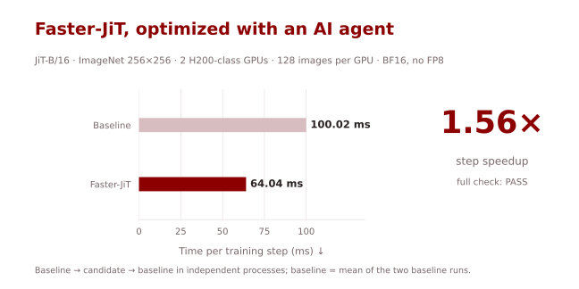
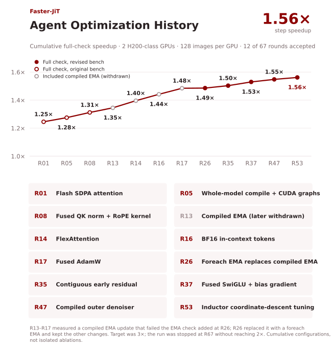
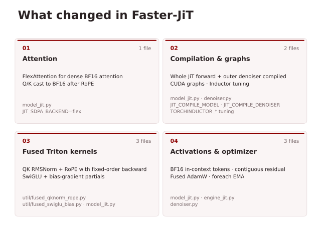

# Faster-JiT

[English](README.md) | [简体中文](README.zh-CN.md)

**AI agent 优化的 JiT-B/16：在 Hopper GPU 上训练步加速 1.56×。**



| 实现 | 每个训练步耗时（毫秒）↓ | 加速比 ↑ |
|---|---:|---:|
| 参考实现 | 100.02 | 1.00× |
| **Faster-JiT** | **64.04** | **1.56×** |

在 **2 张 H200 级 GPU**（Hopper）上用完整检查测得：JiT-B/16，ImageNet 256×256，上游配方，**每卡 128 张图**（全局 batch 256），BF16 autocast，主权重、AdamW 状态和两套 EMA 均为 FP32，**不使用 FP8**。测速直接运行仓库的训练入口 `main_jit.py`，参考实现、优化版、参考实现在独立进程中依次运行，优化版随后通过了检查中的数值关。精确加速比为 **1.5618×**。原定目标是 3×，3× 和后来加的 2× 收尾线都没有达到。

## 快速开始

先准备[环境和 ImageNet](docs/training.md)。优化以环境变量开关的形式加在上游训练代码上；启动脚本会加载这些开关，再运行上游的 JiT-B/16 命令（默认 8 张 GPU，每卡 128 张图）：

```bash
export IMAGENET_PATH=/path/to/imagenet   # 其下有 train/
export OUTPUT_DIR=/path/to/output
bash scripts/train_faster_jit_b16.sh
```

也可以先 `source scripts/configs/faster.env`，再用上游的 `torchrun ... main_jit.py` 命令。测试环境为 **PyTorch 2.8.0 + CUDA 12.8，使用 Hopper GPU**。不设置任何开关时，代码走上游路径。

## 8 卡输入管线

输入**逐位一致**，确定性模式下 **1600 步短训 + 100 步续训**的全部验收项通过。数值验收同时采用
两次默认模式的输入及续训检查、确定性模式短训和完整 batches；默认模式恢复首步 loss 的复现限制见下文。

另一次完整 ImageNet 检查使用 **8 张 80 GB Hopper GPU**，每卡 128 张图（全局 batch 1024），缓存
**原 Pillow 管线的精确中心裁剪结果**以消除输入瓶颈。模型侧开关和训练配方保持不变；这里比较的是
Faster-JiT 原 live 管线与缓存管线，与上面的两卡 1.56× 结论分开。

| 输入管线 | 会话 1：ms/步（图/s） | 会话 2：ms/步（图/s） |
|---|---:|---:|
| 原 live 管线 | 102.48 (9,992) | 101.39 (10,100) |
| 已校验裁剪缓存 | 71.31 (14,360) | 70.39 (14,548) |
| preload 诊断下限 | 71.11 (14,401) | 70.09 (14,610) |

每个会话按 live 参考 → 缓存 → live 参考 → preload 顺序运行，预热 200 步后测五个 100 步窗口。
原 live 数值是两次 live 中位数的平均值，吞吐为八卡合计。缓存相对 preload 的差距为
**+0.28% / +0.42%**，缓存窗口极差为 **2.19% / 1.94%**；两个会话均通过了与 preload 相差不超过 3%、窗口极差不超过 3% 的门槛。

缓存占 **234.6 GiB**，构建耗时 **308.3 秒**，对全部 1,281,167 张参考裁剪逐位校验耗时 **131.7 秒**。
完整 batches 检查通过 576/576 个 rank-step 对，覆盖 epoch 边界；两次 1600 步短训和 100 步续训中，所有
rank 每一步输入均一致（每次 13,600 对），且续训成功。默认模式下，原版参考自身在源码、checkpoint、
输入和编译缓存均相同时，也无法稳定逐位复现续训首步 loss。这属于现有框架栈的非确定性，与输入缓存
改动无关；具体后端原因尚未定位。冻结判卷的默认模式失败记录原样保留；2026-10-21 经监督方裁定，
上述三项联合证据满足数值验收。
确定性模式的输入、初始 loss 位和续训检查均通过，但后续 loss 和最终状态并非逐位一致；该模式的 CUDA graph
行为与默认测速模式不同。移除 PyTorch 加载兼容环境变量后的续训也已通过。这里不新增完整训练或 FID 结论。

要复现该吞吐，先[构建并完整校验缓存](docs/training.md#exact-center-crop-cache-for-eight-gpus)，再导出
`CROP_CACHE_PATH` 并启动训练。`faster.env` 开启 `JIT_CROP_CACHE=1`；缓存缺失或失效时会打印
`fallback` 并使用原管线。实测机器的内存能容纳缓存，较小内存或冷存储读取下的性能尚未验证。
详见[测量与验证方法](docs/training.md#8-gpu-input-pipeline-results)。

## Agent 优化过程

图中每个点都是一次完整检查，两张 H200 级 GPU，每卡 128 张图。



## 主要改动

- **注意力：** 用 FlexAttention 替换上游的 math 注意力（FP32 的 `QK^T` 和 softmax）；Q、K 在 RoPE 之后转成 BF16。
- **编译：** 整个 JiT 前向和外层 denoiser（噪声采样和损失）用 CUDA graph 编译，并由 Inductor 调优逐元素和归约 kernel。
- **融合 Triton kernel：** QK RMSNorm + RoPE，反向按固定顺序归约、不用 atomic；SwiGLU 的 bias 梯度由分块部分和归约得到。
- **激活与优化器：** in-context token 保持 BF16，不再把残差流提升为 FP32；前几层残差流改为连续布局；AdamW 改用 fused 实现；两套 EMA 改用 foreach 更新。



详见[开关表](docs/training.md#switches)和[测速配置](scripts/configs/faster.env)。这些改动会改变浮点舍入，不是无损加速。

## 正确性验证

两卡模型配置通过了完整检查：结构和精确项检查（配方、数据、随机数指纹、调用次数、学习率），隔离的 EMA 检查（4 步 × 366 个张量，与参考实现的更新逐位一致）；记录的 8,760 个张量中有 1,574 个逐位一致而不是全部一致，因此进入统计检查。统计检查从 warmup 之后的状态开始训练 300 步，使用三个配对随机种子；阈值 δ 为参考实现自身在不同种子间、各损失窗口标准差的 2 倍。

| 损失窗口（步） | 均值差 / 参考标准差 | 在 δ = 2σ 内 |
|---|---:|:---:|
| 50–100 | −0.51 | ✓ |
| 100–150 | +0.02 | ✓ |
| 150–200 | −0.05 | ✓ |
| 200–250 | −0.75 | ✓ |
| 250–300 | +0.04 | ✓ |

详见[验证方法](docs/training.md#validation)。

### 40 个 epoch 的 FID

两边都在 8 张 Hopper GPU 上按上游 JiT-B/16 配方训练 40 个 epoch（每卡 128，全局 batch 1024），再用上游的在线评测打分：从第一个 EMA 采样 5 万张，CFG 2.9，对 `fid_stats/jit_in256_stats.npz` 算 FID 和 IS。两次运行的机器、环境、数据和命令都相同，只有代码树和开关不同；Faster-JiT 采样时也开着开关。

| 实现 | FID-50K ↓ | IS ↑ |
|---|---:|---:|
| 参考实现 | 39.07 | 45.86 |
| Faster-JiT | 39.24 | 46.55 |

每边只跑了一次，没有测运行间的波动；两边 FID 相差 0.17。论文只给了 200 和 600 个 epoch 的结果，没有 40 个 epoch 的数字，所以这里只比较两边。这次运行用的是 PyTorch 2.7.1 + CUDA 12.6，不是测速判卷时的 PyTorch 2.8.0。完整的 600 个 epoch 训练尚未运行；**1.56×** 指训练步速度的提升。

## 为什么停在 1.56×

每个 64 ms 的训练步里，GEMM kernel 约占 25–26 ms，已达到本机实测 BF16 矩阵乘吞吐的 90–93%。要到 3×（每步 33.3 ms），留给其余部分的时间只有约 7–10 ms，而这部分目前的 kernel 时间约 34 ms；FP8 不在允许范围内。优化在第 67 轮时停止。


详见[停在这里的原因](docs/training.md#why-it-stopped-here)，以及试过但没有采纳的方向。

## AI4AI-for-Anything 的其他项目

[Faster-RAE](https://github.com/AI4AI-for-Anything/Faster-RAE) · [Faster-LLaVA](https://github.com/AI4AI-for-Anything/Faster-LLaVA) · [Faster-DMD](https://github.com/AI4AI-for-Anything/Faster-DMD) · [Faster-SelfForcing](https://github.com/AI4AI-for-Anything/Faster-SelfForcing)

## 上游 JiT 文档

本项目基于 [LTH14/JiT](https://github.com/LTH14/JiT) `cbc743a`，原作者为 Tianhong Li 和 Kaiming He。[论文](https://arxiv.org/abs/2511.13720) · [MIT 许可证](LICENSE)。原始 README 保存在 [README.upstream.md](README.upstream.md)，并附在下方。

<details>
<summary>展开原始 JiT README：数据集、安装、训练与评测（英文原文）</summary>

## Just image Transformer (JiT) for Pixel-space Diffusion

[](https://arxiv.org/abs/2511.13720)&nbsp;

<p align="center">
  
</p>


This is a PyTorch/GPU re-implementation of the paper [Back to Basics: Let Denoising Generative Models Denoise](https://arxiv.org/abs/2511.13720):

```
@article{li2025jit,
  title={Back to Basics: Let Denoising Generative Models Denoise},
  author={Li, Tianhong and He, Kaiming},
  journal={arXiv preprint arXiv:2511.13720},
  year={2025}
}
```

JiT adopts a minimalist and self-contained design for pixel-level high-resolution image diffusion. 
The original implementation was in JAX+TPU. This re-implementation is in PyTorch+GPU.

<p align="center">
  
</p>

### Dataset
Download [ImageNet](http://image-net.org/download) dataset, and place it in your `IMAGENET_PATH`.

### Installation

Download the code:
```
git clone https://github.com/LTH14/JiT.git
cd JiT
```

A suitable [conda](https://conda.io/) environment named `jit` can be created and activated with:

```
conda env create -f environment.yaml
conda activate jit
```

If you get ```undefined symbol: iJIT_NotifyEvent``` when importing ```torch```, simply
```
pip uninstall torch
pip install torch==2.5.1 --index-url https://download.pytorch.org/whl/cu124
```
Check this [issue](https://github.com/conda/conda/issues/13812#issuecomment-2071445372) for more details.

### Training
The below training scripts have been tested on 8 H200 GPUs.

Example script for training JiT-B/16 on ImageNet 256x256 for 600 epochs:
```
torchrun --nproc_per_node=8 --nnodes=1 --node_rank=0 \
main_jit.py \
--model JiT-B/16 \
--proj_dropout 0.0 \
--P_mean -0.8 --P_std 0.8 \
--img_size 256 --noise_scale 1.0 \
--batch_size 128 --blr 5e-5 \
--epochs 600 --warmup_epochs 5 \
--gen_bsz 128 --num_images 50000 --cfg 2.9 --interval_min 0.1 --interval_max 1.0 \
--output_dir ${OUTPUT_DIR} --resume ${OUTPUT_DIR} \
--data_path ${IMAGENET_PATH} --online_eval
```

Example script for training JiT-B/32 on ImageNet 512x512 for 600 epochs:
```
torchrun --nproc_per_node=8 --nnodes=1 --node_rank=0 \
main_jit.py \
--model JiT-B/32 \
--proj_dropout 0.0 \
--P_mean -0.8 --P_std 0.8 \
--img_size 512 --noise_scale 2.0 \
--batch_size 128 --blr 5e-5 \
--epochs 600 --warmup_epochs 5 \
--gen_bsz 128 --num_images 50000 --cfg 2.9 --interval_min 0.1 --interval_max 1.0 \
--output_dir ${OUTPUT_DIR} --resume ${OUTPUT_DIR} \
--data_path ${IMAGENET_PATH} --online_eval
```

Example script for training JiT-H/16 on ImageNet 256x256 for 600 epochs:
```
torchrun --nproc_per_node=8 --nnodes=1 --node_rank=0 \
main_jit.py \
--model JiT-H/16 \
--proj_dropout 0.2 \
--P_mean -0.8 --P_std 0.8 \
--img_size 256 --noise_scale 1.0 \
--batch_size 128 --blr 5e-5 \
--epochs 600 --warmup_epochs 5 \
--gen_bsz 128 --num_images 50000 --cfg 2.2 --interval_min 0.1 --interval_max 1.0 \
--output_dir ${OUTPUT_DIR} --resume ${OUTPUT_DIR} \
--data_path ${IMAGENET_PATH} --online_eval
```

### Evaluation

PyTorch pre-trained models are available [here](https://www.dropbox.com/scl/fo/3ken1avtsd81ip67b9qpi/AK218ZNvXKSv74igVvht4PQ?rlkey=14gjrblmljewpl6ygxzlr3njm&st=ffkl77al&dl=0).

Evaluate pre-trained JiT-B:
```
torchrun --nproc_per_node=8 --nnodes=1 --node_rank=0 \
main_jit.py \
--model JiT-B/16 (or JiT-B/32) \
--img_size 256 (or 512) --noise_scale 1.0 (or 2.0) \
--gen_bsz 256 --num_images 50000 --cfg 3.0 --interval_min 0.1 --interval_max 1.0 \
--output_dir ${CKPT_DIR} --resume ${CKPT_DIR} \
--data_path ${IMAGENET_PATH} --evaluate_gen
```

Evaluate pre-trained JiT-L:
```
torchrun --nproc_per_node=8 --nnodes=1 --node_rank=0 \
main_jit.py \
--model JiT-L/16 (or JiT-L/32) \
--img_size 256 (or 512) --noise_scale 1.0 (or 2.0) \
--gen_bsz 256 --num_images 50000 --cfg 2.4 (or 2.5) --interval_min 0.1 --interval_max 1.0 \
--output_dir ${CKPT_DIR} --resume ${CKPT_DIR} \
--data_path ${IMAGENET_PATH} --evaluate_gen
```

Evaluate pre-trained JiT-H:
```
torchrun --nproc_per_node=8 --nnodes=1 --node_rank=0 \
main_jit.py \
--model JiT-H/16 (or JiT-H/32) \
--img_size 256 (or 512) --noise_scale 1.0 (or 2.0) \
--gen_bsz 256 --num_images 50000 --cfg 2.2 (or 2.3) --interval_min 0.1 --interval_max 1.0 \
--output_dir ${CKPT_DIR} --resume ${CKPT_DIR} \
--data_path ${IMAGENET_PATH} --evaluate_gen
```

We use a customized [```torch-fidelity```](https://github.com/LTH14/torch-fidelity)
to evaluate FID and IS against a reference image folder or statistics. You can use ```prepare_ref.py```
to prepare the reference image folder, or directly use our pre-computed reference stats
under ```fid_stats```.

### Acknowledgements

We thank Google TPU Research Cloud (TRC) for granting us access to TPUs, and the MIT
ORCD Seed Fund Grants for supporting GPU resources.

### Contact

If you have any questions, feel free to contact me through email (tianhong@mit.edu). Enjoy!

</details>
