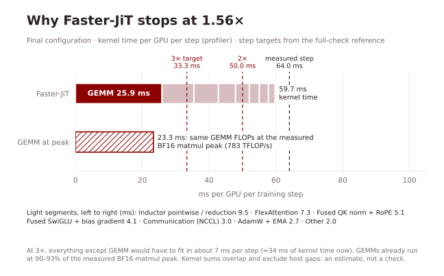

# Training and reproduction

The optimizations are environment switches on the upstream trainer (`main_jit.py`). Every `JIT_*` switch is off unless
set; with none set, the code runs the upstream path. The measured configuration is
[`scripts/configs/faster.env`](../scripts/configs/faster.env). Its model-side switch values match
[`.harness/config.json`](../.harness/config.json) and
[`optimizations/flex_pointwise_tune.json`](../optimizations/flex_pointwise_tune.json); it additionally enables the
[verified input cache](#exact-center-crop-cache-for-eight-gpus).

## Environment

The benchmark ran on Hopper GPUs (compute capability 9.0, about 140 GiB each) with:

| Package | Version |
|---|---|
| Python | 3.10.22 |
| PyTorch | 2.8.0+cu128 (CUDA 12.8) |
| torchvision | 0.23.0+cu128 |
| Triton | 3.4.0 (bundled with PyTorch) |
| NCCL / cuDNN / cuBLAS | 2.27.3 / 9.10.2.21 / 12.8.4.1 (PyTorch wheels) |
| NumPy / SciPy | 1.26.0 / 1.15.3 |
| timm / einops / OpenCV | 0.9.16 / 0.8.2 / 4.11.0 |
| torch-fidelity | 0.4.0 ([LTH14 fork](https://github.com/LTH14/torch-fidelity), used by upstream for FID) |

The upstream `environment.yaml` pins PyTorch 2.5.1. The switches use FlexAttention, `torch.library.custom_op` and
Inductor options. The original two-GPU timing used PyTorch 2.8.0; the separate eight-GPU input check below uses
PyTorch 2.7.1. One way to build the original timing environment:

```bash
conda create -n faster-jit python=3.10 -y
conda activate faster-jit
pip install torch==2.8.0 torchvision==0.23.0 --index-url https://download.pytorch.org/whl/cu128
pip install numpy==1.26.0 scipy==1.15.3 timm==0.9.16 einops==0.8.2 opencv-python==4.11.0.86 tensorboard
pip install git+https://github.com/LTH14/torch-fidelity.git@master
```

A fresh installation with these commands has not been benchmarked; check timings against the reference on your
machine (see [benchmark protocol](#benchmark-protocol)).

## Data

ImageNet-1k training images in `ImageFolder` layout, as upstream:

```text
$IMAGENET_PATH/
  train/n01440764/*.JPEG
  train/...
```

No images, checkpoints or FID statistics beyond the upstream `fid_stats/` files are added by this repository.

## Exact center-crop cache for eight GPUs

The optional `JIT_CROP_CACHE=1` path stores the deterministic output of the existing Pillow loader and
`util/crop.py` once, as uncompressed HWC uint8. It does not change JPEG decoding, BOX/BICUBIC resizing or pixel
values. Training still runs `RandomHorizontalFlip` per sample, using the same worker RNG draws. Sampler order,
12 workers per rank, batching, pinning, and GPU float32 normalization stay unchanged. Do not change worker count
when reproducing exact batches: that changes which worker draws each flip.

Build and verify on local disk, from the repository root, using the same environment as training:

```bash
export IMAGENET_PATH=/path/to/imagenet
export CROP_CACHE_PATH=/path/to/local/crop-cache
python -m util.crop_cache build --data_path "$IMAGENET_PATH" --cache_path "$CROP_CACHE_PATH" --workers 120
python -m util.crop_cache verify --data_path "$IMAGENET_PATH" --cache_path "$CROP_CACHE_PATH" --full --workers 120
```

The full ImageNet-1k train cache (1,281,167 images at 256×256) uses **234.6 GiB** for crops plus 9.8 MiB for labels.
On the measured 128-core, 1 TiB RAM host, building it took **308.3 s**, and full verification took **131.7 s**.
Both operations are CPU-only; run them before training or timing. The builder refuses to overwrite an existing
cache and requires at least 200 GB of disk space to remain free. Use a new empty directory to rebuild.

`verify --full` recomputes **every** crop through the original pipeline, compares every byte and label, and checks
all cache chunk hashes. A sample-only check does not authorize training. Full verification writes a receipt;
training requires it and checks file identity, dataset order, crop source, Pillow/NumPy versions, labels and four
reference crops without consuming augmentation RNG. Keep the source dataset and cache immutable after verification.
Rebuild and reverify after any source-data, crop-code or environment change; file identity checks are not a substitute
for immutable data. Verification hashes and data paths remain local.

The measured configuration in `scripts/configs/faster.env` enables `JIT_CROP_CACHE=1`; export `CROP_CACHE_PATH`
before using the launcher. With a missing, stale or unverified cache the trainer prints `JIT_CROP_CACHE fallback`
and uses the original ImageFolder pipeline. Such a run does not qualify for cached-input timing. Without any
switches, the original pipeline is unchanged. To disable caching after sourcing the configuration, use
`export JIT_CROP_CACHE=0` before invoking `main_jit.py` directly.

The measured cache fits in host memory and is served through the OS page cache. The same throughput is not promised
with less RAM, remote storage or cold storage reads. This cache only covers the training center crop; random
augmentation and the training recipe remain online.

## Launch

```bash
export IMAGENET_PATH=/path/to/imagenet
export OUTPUT_DIR=/path/to/output
bash scripts/train_faster_jit_b16.sh            # NPROC=8 by default, 128 images per GPU
```

The script sources the switches and runs the upstream JiT-B/16 command (600 epochs, 5 warm-up epochs, `blr 5e-5`,
learning rate scaled by the global batch). Extra arguments are passed to `main_jit.py`. `--online_eval` is not added
by default; the [40-epoch FID run](#40-epoch-fid) added it and sampled with the switches on (PyTorch 2.7.1).

Resume uses `--resume /path/to/output` to read `checkpoint-last.pth`, including the model, both EMAs, optimizer and
next epoch. These training checkpoints include `argparse.Namespace` metadata, so the trainer explicitly calls
`torch.load(..., weights_only=False)` for trusted own checkpoints. This fixes the default `weights_only=True`
rejection on PyTorch 2.6 and later; `TORCH_FORCE_NO_WEIGHTS_ONLY_LOAD` is not needed. Only load checkpoints you trust.
The sampler restarts the saved epoch's successor as upstream; mid-epoch worker RNG state is not saved. Keep the
training switches and worker count unchanged when resuming.

At start-up, the enabled switches print a line (for example `JIT_COMPILE_DENOISER enabled ...`). A fused path that
cannot handle its input prints a line containing `fallback` and runs the upstream code instead. Before trusting a
timing, check the log for `fallback`, for `skipping cudagraphs due to` and for recompile-limit messages; the
measured runs had none.

## Switches

| Switch | What it does | Files | Adopted | Numerics |
|---|---|---|---|---|
| `JIT_SDPA_BACKEND=flex` | FlexAttention (Triton) for dense BF16 attention with zero dropout. Q and K are cast to BF16 after RoPE. `flash` selects PyTorch Flash SDPA (R01); `reference` (default) keeps the upstream math path with FP32 `QK^T`. | `model_jit.py` | R01 flash, R14 flex | Local BF16 rounding of Q/K; different attention kernel |
| `JIT_COMPILE_MODEL=1`, `JIT_COMPILE_MODE=reduce-overhead` | Compiles the whole `JiT.forward` with CUDA graphs (upstream compiles each block separately). | `model_jit.py` | R05 | Compiler reordering |
| `JIT_FUSED_QK_PREP=1` | Triton kernel for QK RMSNorm + interleaved RoPE + head layout. The backward reproduces the eager BF16 rounding boundaries and reduces the norm-weight gradients with a fixed tree, without atomics. Requires `flash` or `flex`, head dim 64. | `util/fused_qknorm_rope.py`, `model_jit.py` | R08 | Not bitwise |
| `JIT_COMPILE_EMA=1` | **Historical, keep 0.** Compiles the EMA loop with CUDA graphs. It passed the original check but failed the revised EMA check (4 of 366 tensors had a larger max-abs error against FP64 than the reference). | `denoiser.py` | R13, withdrawn at R26 | Failed |
| `JIT_BF16_CONTEXT=1` | Casts the 32 in-context tokens to BF16 before concatenation. Upstream concatenates FP32 tokens, which promotes the residual stream of blocks 4–11 to FP32. | `model_jit.py` | R16 | Residual stream of blocks 4–11 in BF16 |
| `JIT_FUSED_ADAMW=1` | `torch.optim.AdamW` with `fused=True`; unchanged hyperparameters, FP32 master weights and moments. Moves checkpoint step counters to the GPU. | `engine_jit.py` | R17 | Not bitwise |
| `JIT_FOREACH_EMA=1` | Both EMAs updated with `torch._foreach_mul_` and `torch._foreach_add_`, keeping the reference's multiply-then-add rounding. | `denoiser.py` | R26 | Bitwise identical in the isolated EMA check |
| `JIT_CONTIGUOUS_EARLY_RESIDUAL=1` | Makes the residual stream contiguous after patch and position embedding (the convolution output is channel-strided). | `model_jit.py` | R35 | Layout only; compiled reductions may reorder |
| `JIT_SWIGLU_BIAS_FUSION=1` | Triton SwiGLU forward/backward that also produces the `w12` bias gradient from per-tile FP32 partials (fixed reduction, no atomics). Guarded to batch 128, 256 or 288 tokens, width 768, BF16 autocast. | `util/fused_swiglu_bias.py`, `model_jit.py` | R37 | Different bias-reduction grouping |
| `JIT_COMPILE_DENOISER=1` | Compiles the outer `Denoiser.forward` (noise sampling and loss) with CUDA graphs. Inductor `fallback_random` keeps the ATen random operators. | `denoiser.py` | R47 | RNG fingerprints checked exactly |
| `TORCHINDUCTOR_MAX_AUTOTUNE_POINTWISE=1`, `TORCHINDUCTOR_COORDINATE_DESCENT_TUNING=1` | Stock Inductor tuning of pointwise and reduction kernels at compile time. | — | R53 | Kernel configuration only |
| `JIT_CROP_CACHE=1` | Reads fully verified original center crops from `CROP_CACHE_PATH`; keeps per-worker flip RNG and original batching. Missing/stale caches print `fallback`. | `main_jit.py`, `util/crop_cache.py` | 2026-10-21 | Bitwise-identical model inputs |
| `TORCH_LOGS=+inductor` | Logging only; set in the measured run to record the tuning choices. | — | R53 | None |

"Not bitwise" means that the change alone is not claimed to reproduce the reference bit for bit. The numerical
verdict applies to the combined configuration; see [validation](#validation).

`optimizations/*.json` keeps the configuration of every adopted step. Four of them
(`fused_qk_ema_graph.json`, `flex_fused_qk_ema_graph.json`, `flex_bf16_context.json`, `flex_context_fused_adamw.json`)
set `JIT_COMPILE_EMA=1` and therefore do not pass the revised check; they are kept only to reproduce the history.

## 8-GPU input pipeline results

Measured 2026-10-21 on eight NVIDIA L20Z GPUs (81,559 MiB each), 128 CPU cores and 1 TiB RAM. The workload is
full ImageNet-1k train, JiT-B/16 at 256×256, 128 images per rank / global batch 1024, default 12 workers per rank,
and the same 12 model-side switches and two Inductor flags. No FP8, FP16, optimizer or recipe change. Software:
Python 3.12.12, PyTorch 2.7.1+cu126, torchvision 0.22.1+cu126, Triton 3.3.1, Pillow 11.3.0, NumPy 1.26.4.
The input-cache source is `1ba75aa`, with the separate trusted-checkpoint resume fix in `bff0913`.

CPU attribution identified PIL decode, BOX/BICUBIC resize and center crop as the bottleneck. The change caches
only those deterministic results; horizontal flips still draw once per sample in the original worker assignment.
Changing worker count is not equivalent: a 16-worker negative control changed flips from batch 12 onward.

Two independent frozen-bench sessions run reference live → candidate live → reference live → reference preload.
Each arm starts with fresh compile caches, warms up for 200 steps, then measures five consecutive 100-step windows
with synchronized boundaries and no profiler. Each window uses the slowest rank. Startup, compile, checkpoints
and epoch transitions are excluded. Preload cycles 64 real augmented batches as a diagnostic floor; the candidate
continues sampling the real dataset. Before = mean of the two reference-live median windows.

| Session | Before (ms) | Cache (ms) | Preload (ms) | Cache vs preload | Cache window range | Live speedup |
|---|---:|---:|---:|---:|---:|---:|
| 1 | 102.48 | 71.31 | 71.11 | +0.28% | 2.19% | 1.437× |
| 2 | 101.39 | 70.39 | 70.09 | +0.42% | 1.94% | 1.440× |

Both sessions are valid and pass both 3% targets. All timing windows have zero compilations, the expected
optimizer/EMA counts, and no fallback, skipped-CUDA-graph or recompile-limit signatures. The first session's
worst-rank window-mean loader wait drops from 33.39 ms to 0.29 ms; the longest wait drops from 620.49 ms to 0.83 ms.
This result is separate from the original two-GPU model-optimization benchmark and from time-to-FID.

Input validation uses the frozen observer at the DDP forward boundary: float32 normalized images and int64 labels,
including shape, dtype and stride. Full batches pass all 576 selected rank-step SHA256 pairs across an epoch
boundary. Both default shorttrain attempts run 1600 fresh steps (one full epoch plus 349 steps) and 100 resumed steps on all
eight ranks: every input checksum matches (13,600 rank-step pairs per invocation) and both trees restore the
candidate's epoch-0 checkpoint. Phase-A step-0 loss bits match; phase-B step-0 bits differ, so the original default
shorttrain verdicts remain false. Resumed sampler labels match uninterrupted epoch 1. Both EMAs and AdamW state are
included in checkpoint verification; protected model/loss/kernel/schedule sources remain unchanged.

Losses and final training states are not bitwise reproducible on this stack, even for unchanged code. Here the
first phase-A loss mismatch is at step 11; maximum absolute rank-mean loss differences
are 0.016902201 (phase A) and 0.0075864429 (phase B). The frozen reference-vs-reference
phase-A maximum is 0.019957064.
See the [dated aggregate evidence](experiments/2026-10-21-input-pipeline/summary.json) for all timing windows and
per-100-step mean/max loss differences alongside the reference band. The exact crop and input checks establish the
input contract; protected sources are unchanged.

Repeating the unchanged reference phase B with identical source, checkpoint, inputs and shared compile cache also
changed initial loss bits on four ranks. A separate full reference-vs-reference control passes, so the default
restored-loss check is not reliably reproducible. This nondeterminism is present in the existing framework stack,
independent of the input-cache change; the exact backend cause is not isolated. Both failed default verdicts and
the reference-self controls are retained in the aggregate evidence.

A complete run with the frozen bench's existing `--deterministic` option **passes** all checks over 1600 + 100 steps:
inputs, both initial losses and resume checks agree. Phase-A losses first differ at step 56; maximum absolute
rank-mean differences are 0.014552632 (A) and 0.004941608 (B). This mode sets deterministic algorithms and the cuBLAS
workspace configuration. Each arm logs eight CUDA-graph skips, unlike the default runs. This is numerical
validation for that execution mode; the two default-mode paired sessions above establish performance. A passing
shorttrain does not mean every later loss or final state is bitwise identical.

On 2026-10-21, the benchmark owner corrected the acceptance policy because the unchanged reference itself cannot
reliably pass the default restored step-0 loss-bit check. Acceptance requires all three:

1. Both default shorttrains have identical inputs on all 13,600 rank-step pairs and `resume_ok=true`.
2. The complete deterministic-mode shorttrain passes inputs, step-0 loss bits in both phases and resume.
3. Full batches pass on the final commit.

All three are satisfied. The frozen benchmark and its raw verdicts are unchanged; the combined evidence is the
accepted numerical result. No pixel values, precision, model-side switches or training recipe are changed, and no
new long-training or quality result is claimed.

The frozen shorttrain bench injects `TORCH_FORCE_NO_WEIGHTS_ONLY_LOAD=1` for its reference arm. The candidate uses
explicit `weights_only=False`, so it does not need that workaround. An additional 100-step candidate phase-B replay
through the same frozen observer, same checkpoint and shared compile cache removes the environment variable and
completes on all ranks with identical inputs versus the original candidate phase B. Its initial loss bits differ;
that additional replay proves resume compatibility and is separate from the combined numerical acceptance above.

The benchmark harness and raw artifacts remain external to this repository. The repository provides the cache
builder/verifier, CPU regression test (`python -m unittest discover -s tests`) and the aggregate evidence above.

## Memory and compile time

Measured in the final full check (2 GPUs, 128 images per GPU):

| | Reference | Faster-JiT |
|---|---:|---:|
| Peak allocated memory per GPU | 25.84 GiB | 17.73 GiB |
| Process start to first training step | 54.1 s | 194.2 s |
| Steady-state images/s (both GPUs) | 2,558.5 | 3,997.5 |

The longer start-up comes from whole-model compilation, CUDA-graph capture and coordinate-descent tuning with a cold
compile cache. It is paid once per process and is excluded from the step time.

## Benchmark protocol

- **Workload:** the upstream JiT-B/16 command (`--batch_size 128 --blr 5e-5 --epochs 600 --warmup_epochs 5`, BF16
  autocast, FP32 master weights, AdamW β = (0.9, 0.95), two FP32 EMAs with decays 0.9999 and 0.9996), on 2 GPUs
  instead of 8. The per-GPU batch is unchanged, so the per-GPU work matches the 8-GPU recipe; the global batch is 256.
- **Entry point:** the timer runs the repository's real `main_jit.py` (via `runpy` on a copy of the source tree) and
  observes complete DataLoader iterations, so a step includes data loading, forward, backward, AdamW, both EMA updates
  and gradient/metric communication. Process start, compilation and warm-up, online evaluation and checkpoint writes
  are excluded.
- **Data:** a fixed ImageNet subset of 32,000 original JPEGs (the first 32 files by name in each of the 1,000 classes),
  unchanged center crop and random horizontal flip, content-hashed before and after every run. At global batch 256
  an epoch has 125 steps.
- **Windows:** 30 warm-up steps, then three 30-step windows inside one epoch; a run reports its median window. A run
  is invalid if its windows differ by more than 10%, if the log shows a recompile-limit or CUDA-graph-skip message, or
  if inputs or sources changed.
- **Full check:** reference → candidate → reference, each in an independent process with a cold compile cache.
  Speedup = mean of the two reference runs / candidate. A candidate must exceed max(1.02, 1 + 2 × the relative
  difference between the two reference runs).
- **Final check:** reference runs 100.06 and 99.98 ms (spread 0.08%), candidate windows 64.04 / 69.61 / 63.96 ms
  (spread 8.8%, median 64.04 ms) → **1.5618×**. The first full check of this configuration was invalid (window spread
  28%) and was rerun with unchanged code.

For scale: the unmodified upstream command on the full ImageNet training set ran at about 101–104 ms per step on
these 2 GPUs (steady state of a 12-minute run, 26 GB peak per GPU), close to the 100.02 ms reference measured on
the fixed subset.

Single-run timings (`time`) were used only to screen candidates. All speedups and step times in the README and in the
history figures come from full checks; the GEMM time budget comes from profiles and is marked as an estimate.

## Validation

The check runs four gates in order and stops at the first failure: structure, benefit, bitwise, statistical.

1. **Structure.** Command line, recipe, hyperparameters, data, augmentation, model structure, loss, label drop and
   optimizer semantics are compared with the reference source (AST-based); the first input batches must be bitwise
   identical; a recorded short case must match exactly in step counts, learning rates, random-number fingerprints,
   per-module call counts and cross-rank relations.
   An **EMA semantic check** (added at R26) verifies the decays (exactly 0.9999 and 0.9996), one update of each EMA
   after each optimizer step, coverage of all parameters and FP32 state. It also runs the reference and candidate
   `update_ema` for four steps from a frozen checkpoint with perturbed parameters; each tensor must be bitwise
   identical, or its squared-L2 and max-abs error against an FP64 update must not exceed the reference's.
2. **Benefit.** The timing rule above.
3. **Bitwise.** A deterministic 3-step case on 2 GPUs from a post-warm-up checkpoint records the loss, all gradients,
   parameter updates and values, both EMAs and the AdamW state (8,760 tensors). If all are bitwise identical, the
   check passes here.
4. **Statistical.** Otherwise, 300-step training trajectories with deterministic kernels start from the
   post-warm-up checkpoint with matched seeds. Endpoints are the mean training loss over steps 50–100, 100–150,
   150–200, 200–250 and 250–300. The tolerance δ = 2σ, where σ is the reference's seed-to-seed standard deviation
   frozen from 10 reference seeds before any candidate was judged. With 3 seeds: pass if every endpoint's mean
   difference is within δ; fail if any exceeds δ with paired-t p < 0.05; otherwise extend to 6 seeds.

The post-warm-up checkpoint comes from continuing the reference training on full ImageNet to the end of epoch 4
(25,020 optimizer steps), so the learning rate has left the warm-up ramp.

**Final configuration:** no exact-item failures; 1,574 of 8,760 recorded tensors bitwise identical, so the bitwise
gate did not pass; the isolated EMA check was bitwise identical on 4 × 366 tensors; the statistical gate passed with
3 seeds:

| Loss window (steps) | Mean difference / reference σ | Within δ = 2σ |
|---|---:|:---:|
| 50–100 | −0.51 | ✓ |
| 100–150 | +0.02 | ✓ |
| 150–200 | −0.05 | ✓ |
| 200–250 | −0.75 | ✓ |
| 250–300 | +0.04 | ✓ |

Before optimization started, the check was tested on known candidates: unchanged code passed the bitwise gate; a
changed hyperparameter, label drop set to 0 and a missing second EMA were rejected; an eager-mode variant of the
reference passed the statistical gate; unchanged code timed against itself was judged "no benefit". After the EMA
revision, a decay of 0.9998, a missing second EMA and an EMA update moved before the optimizer step were rejected,
and the foreach EMA update passed.

Limits of this evidence:

- The trajectories cover 300 post-warm-up steps and the training loss only. Beyond the check, a paired 40-epoch run
  measured FID (below); full 600-epoch training has not been run.
- Numerical recording runs in deterministic mode. In that mode two CUDA-graph captures in the FlexAttention path are
  skipped; the timed runs had no skips. The numerical verdict covers the deterministic execution path.
- Allowed precision changes were local (BF16 rounding inside attention, the in-context tokens and fused kernels).
  FP8 was not allowed and is not used; master weights, AdamW states and both EMAs stay FP32.

### 40-epoch FID

Outside the check, both arms were trained for 40 epochs and scored with the upstream online evaluation:

- Recipe: upstream JiT-B/16 command with `--epochs 40 --online_eval` (8 GPUs, 128 images per GPU, global batch
  1024, `blr 5e-5`, 5 warm-up epochs, default seed). The two runs used the same machine, environment, data and
  command; only the code tree (upstream vs. this repository) and the switches in `scripts/configs/faster.env`
  differed. `TORCH_LOGS=+inductor` was left off.
- Evaluation: 50,000 samples from the first EMA, CFG 2.9, interval [0.1, 1.0], FID and IS from the LTH14
  torch-fidelity fork against `fid_stats/jit_in256_stats.npz`. Faster-JiT sampled with its switches on.
- Environment: 8 Hopper GPUs (80 GB), PyTorch 2.7.1 + CUDA 12.6. This differs from the PyTorch 2.8.0 + CUDA 12.8
  stack of the timing check.

| Implementation | FID-50K ↓ | IS ↑ |
|---|---:|---:|
| Reference | 39.07 | 45.86 |
| Faster-JiT | 39.24 | 46.55 |

Each arm was run once, so run-to-run variance was not measured; the two FIDs differ by 0.17. The paper reports
200- and 600-epoch results only, so these 40-epoch numbers are compared with each other, not with the paper.

## Optimization history

All rows are full checks of cumulative configurations (data in
[`performance-views/history.json`](performance-views/history.json)).

| Round | Commit | Change | Reference (ms) | Faster-JiT (ms) | Speedup | Check |
|---|---|---|---:|---:|---:|---|
| R01 | `081d45e` | Flash SDPA attention | 100.13 | 80.39 | 1.2456× | original |
| R05 | `dadd8bc` | Whole-model compile + CUDA graphs | 100.52 | 78.83 | 1.2751× | original |
| R08 | `14e2b7a` | Fused QK norm + RoPE kernel | 100.19 | 76.36 | 1.3120× | original |
| R13 | `c67dd25` | Compiled EMA (withdrawn at R26) | 99.94 | 74.30 | 1.3451× | original, compiled EMA |
| R14 | `5b4df63` | FlexAttention | 100.43 | 71.94 | 1.3960× | original, compiled EMA |
| R16 | `036756d` | BF16 in-context tokens | 100.24 | 69.53 | 1.4417× | original, compiled EMA |
| R17 | `dda944d` | Fused AdamW | 99.84 | 67.25 | 1.4847× | original, compiled EMA |
| R26 | `9a2a498` | Foreach EMA replaces compiled EMA | 99.89 | 67.22 | 1.4860× | revised |
| R35 | `c3a51f9` | Contiguous early residual | 99.97 | 66.51 | 1.5032× | revised |
| R37 | `a5fa4a3` | Fused SwiGLU + bias gradient | 100.37 | 65.61 | 1.5298× | revised |
| R47 | `332e101` | Compiled outer denoiser | 100.05 | 64.63 | 1.5480× | revised |
| R53 | `19b7549` | Inductor coordinate-descent tuning | 100.02 | 64.04 | 1.5618× | revised |

"Original" and "revised" refer to the check before and after the EMA semantic check was added at R26. Re-judged
with the revised check, the R17 configuration was rejected because of its compiled EMA; R26 replaced the compiled EMA
with the foreach update and kept the other changes. R35, R37, R47 and R53 were also compared with the previous best
in paired ABBA timings before adoption, because their increments were close to the timing noise.

## Why it stopped here

The run targeted 3× (33.3 ms per step) and later accepted 2× (50.0 ms) if profiles showed 3× to be out of reach. It
was stopped after 67 rounds at 1.5618× (64.04 ms).



- **GEMMs are close to the hardware limit.** In profiles of the final configuration, GEMM kernels take 25.2–25.9 ms
  per GPU per step. The linear and patch-embedding layers need about 1.83 × 10¹³ FLOPs per GPU per step (forward
  and backward, 128 images), i.e. 705–725 TFLOP/s, or 90–93% of the 783 TFLOP/s measured with a large BF16 matmul
  microbenchmark on this GPU. Even at that peak, the GEMMs alone would take 23.3 ms.
- **3× leaves almost nothing for the rest.** At 33.3 ms, attention, normalization and elementwise kernels, the fused
  kernels, AdamW and EMA, communication and host gaps would have to fit in roughly 7–10 ms. They take about 34 ms of
  kernel time now (Inductor pointwise/reduction 9.5, FlexAttention 7.3, QK norm + RoPE 5.1, SwiGLU 4.1, NCCL 3.0
  partly overlapped, AdamW + EMA 2.7, other 2.0).
- **2× would need another ~14 ms.** After R37, 30 rounds went to the remaining hotspots one at a time (table
  below). The two adopted changes gave about 1.6% (R47) and 3.1% (R53) in paired timings; the others showed no
  resolvable gain. In later rounds a slow middle timing window recurred (window spreads up to about 30%), which made
  gains of about 1% hard to resolve.
- FP8 GEMMs, the obvious lever for the GEMM share, were excluded by the task rules.

### Directions tried and not adopted

Single-run timing screens unless noted; the best adopted configuration at the time is given for comparison.

| Rounds | Direction | Result |
|---|---|---|
| R01 | cuDNN SDPA | 77.43 ms vs 81.63 ms for Flash, but it has no deterministic mode, so it could not be validated; removed |
| R02 | Compiled EMA, default mode | Three timing runs invalid (window spread 18–33%) |
| R03 | Inductor pointwise tuning (early graph) | 80.25 vs 80.39 ms, no gain; this tuning was adopted at R53 on the later graph |
| R04, R24, R38, R43, R48 | GEMM autotuning: ATen + Triton, persistent TMA templates, exhaustive subsets for the main shapes | R04, R24: no end-to-end gain. R43, R48: the cuBLAS (ATen) kernel won all eight searched shapes. R38: the full exhaustive search did not finish compiling within a round |
| R06, R11 | Efficient SDPA; math SDPA with BF16 reductions | 82.95 / 81.58 ms, slower |
| R07, R23 | RMSNorm backward rewritten in PyTorch; hand-written fused RMSNorm backward | 78.30 / 69.12 ms, no gain |
| R09 | Foreach EMA | 74.09 ms, rejected by the original EMA rule (code identical to the reference required); adopted at R26 |
| R10 | BF16 norm output for modulation | 75.92 vs 76.36 ms, below the noise threshold |
| R12 | Fused SwiGLU activation kernel | Full check PASS (1.321×), but paired timings showed no stable gain over R08 |
| R15, R18, R22, R34, R39 | FlexAttention / QK-kernel tile sizes, launch configurations, mask hints, a repaired TMA forward, stock config search | No gain |
| R19, R28, R42, R55 | QK kernel: split Q/K programs, BNHD output layout, FMA variants, traversal order | No gain |
| R40, R41 | Attention backward fused with the QK norm/RoPE backward | 72.88 ms and 66.44 ms vs 65.61 ms, slower |
| R20, R32, R36, R49, R65 | NCCL protocols, DDP graph partitioner, BF16 gradient compression, compiled autograd, C++ all-reduce hook | No gain |
| R29, R31, R50, R64 | No post-optimizer device sync; single-kernel dual EMA; EMA CUDA graphs | No gain |
| R30, R51, R52, R56, R58 | Column-major weights; FP32-output weight-gradient GEMM; cuBLASLt split-K weight gradient | No gain (R56 failed: workspace allocated inside the CUDA-graph pool; fixed at R58, still no gain) |
| R33, R54, R59–R63 | Residual + norm + modulation fusions, norm-weight folding | No gain; three timing runs of the folding were invalid |
| R45 | Inductor multi-kernel / cooperative reductions | +0.44% (below threshold) / 125.72 ms |
| R62 | Python GC deferred to epoch boundaries | No gain |
| R66–R67 | Overlap the loss read-back with `zero_grad` | Unfinished when the run was stopped |
